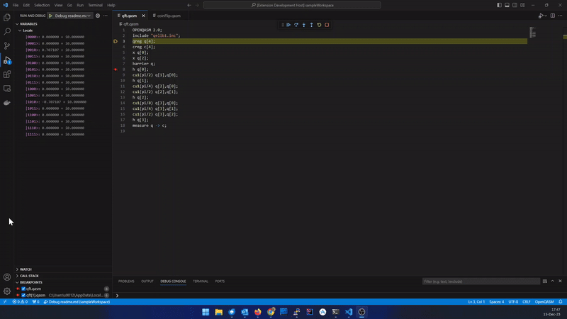
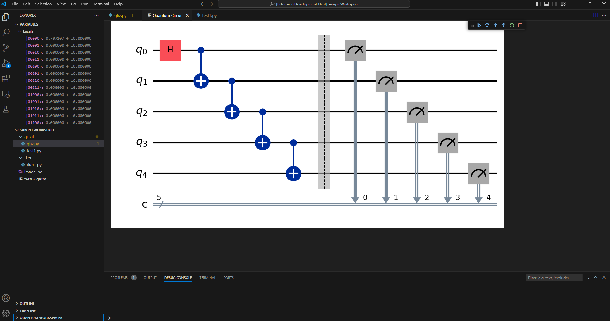
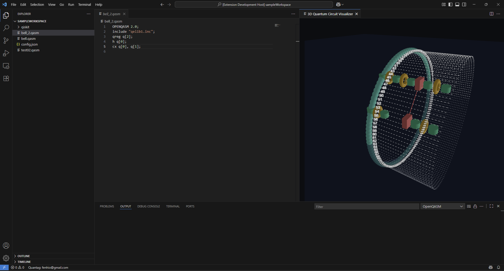
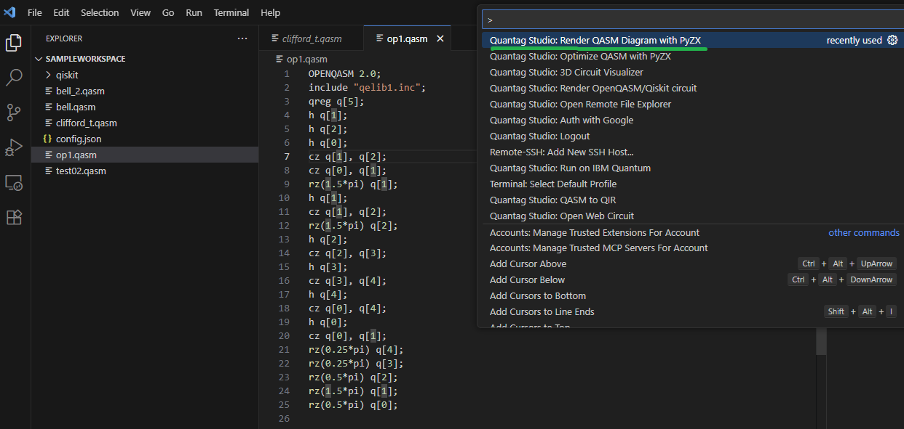
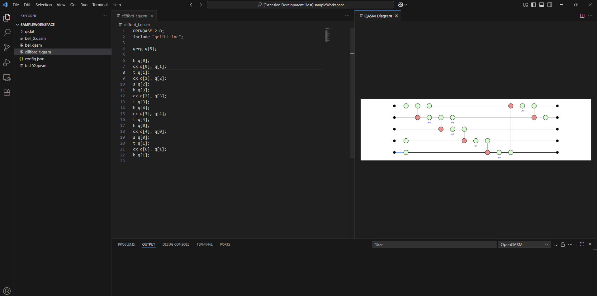
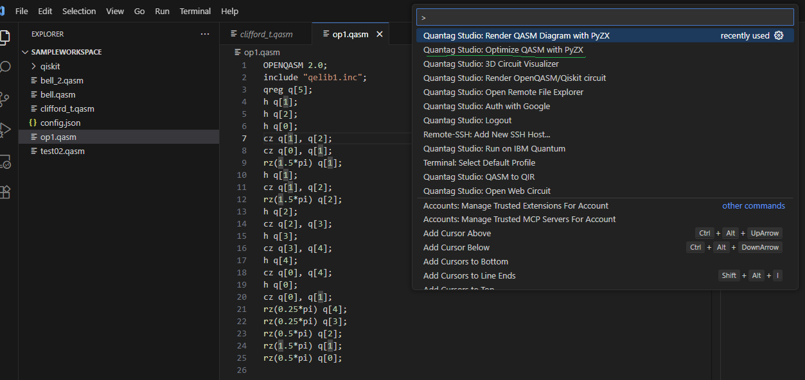
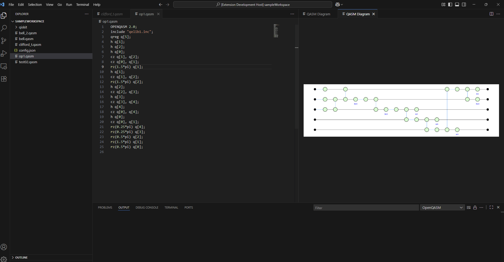

# Quantag Studio — Quantum Debugger & Toolkit for VS Code

**Quantag Studio** (by Quantag IT Solutions GmbH) allows debugging, transpiling, optimizing, and visualizing quantum programs written in **OpenQASM**, **Qiskit**, **pyTKET**, **Quantinuum Guppy**, and **NVIDIA CUDA-Q** (Python and C++).

**OpenQASM** debugger connects to remote Quantum Virtual Machine ( [QVM](https://github.com/quantag/qdb-qscore) ) using [Debug Adapter Protocol](https://microsoft.github.io/debug-adapter-protocol).

It supports *step*, *continue*, *breakpoints*, *exceptions*, and
*variable access*.

## Bulding extension
```
git clone https://github.com/quantag/qasm-adapter-vscode.git

npm install --save-dev esbuild
```

## Description 

Program in OpenQASM executed step by step on remote QVM and its state shown in VS Code in 'Variables' window.
Program in python which uses Qiskit or TKET frameworks loaded to QVM and converted to OpenQASM code.
This OpenQASM code can be views in 'Disassembly' window.

Using commands it is possible to render Qiskit and TKET circuits directly in VS Code (Qiskit) or in external browser (TKET).

Support of Quantinuum [guppy](https://docs.quantinuum.com/guppy/) [github](https://github.com/CQCL/guppylang)

Support of [nVidia CUDA-Q](https://developer.nvidia.com/cuda-q) kernels 

*These commands can be used only after starting debugging session.*

More information about quantum debugger adapter can be found
[here](https://quantum.quantag-it.com/).

Samples can be downloaded from [here](https://studio.quantag-it.com/samples).

Extension versions in .vsix can be downloaded from [here](https://quantag-it.com/pub/qdb/versions/)

Detailed documentation of extension can be downloaded as PDF from [here](https://quantag-it.com/pub/qdb/QSextensionDocs.pdf)

## Using OpenQASM debugger

* Install the **OpenQASM** extension in VS Code.
* Open OpenQASM or python scripts which uses Qiskit or TKET.
* Switch to the debug viewlet and press the gear dropdown.
* Select 'Debug circuit' to start debugging.

You can now 'step through' the file, set and hit breakpoints, and run into exceptions (if the word exception appears in a line).



Using command 'Render Qiskit Circuit' in Commands Palette you can render circuit directly within VS Code. 




## 3D Circuit visualization

Open .qasm file and execute command *3D Circuit Visualizer* from Command Palette



## ZX Calculus Support

Open .qasm file and execute command *Render QASM Diagram with PyZX* from Command Palette





Open .qasm file and execute command *Optimize QASM with PyZX* from Command Palette




## Build and Run

* Clone the project [https://github.com/quantag/qasm-adapter-vscode](https://github.com/quantag/qasm-adapter-vscode)
* Open the project folder in VS Code.
* Press `F5` to build and launch Debugger in another VS Code window.
* In the explorer view of the new window open the 'program' file with .qasm or .py extension
* Set some breakpoints
* From the editor's "Run and Debug" toolbar dropdown menu select "Debug Circuit"
* From Command Pallete choose 'Quantag Studio: Render Circuit' to visualize circuit in new tab.

## Which files are uploaded (VS Code desktop)

On VS Code desktop the debugger runs on the Quantag server, so before a debug or run session the extension uploads the program to it. Only the program and what it needs are uploaded, not the whole workspace:

* **Project root:** the nearest folder above the program with `config.json`, `requirements.txt` or `pyproject.toml` (not above the workspace folder); without one, the program's folder. Paths on the server are relative to it, and the program runs with the project root as its working directory.
* **Local dependencies,** followed recursively inside the project root: Python imports (from the program's folder and the project root, relative imports, the `__init__.py` of each package), C++ `#include "..."` and OpenQASM `include "..."`. Installed packages (qiskit, numpy, ...) are not uploaded: they are on the server.
* **Data files** the program reads: list them in `files` in the project root's `config.json`, as globs relative to the project root. `exclude` removes files from the upload; the project's `.gitignore` applies to `files`.

```
{
  "files": ["data/**", "params.json"],
  "exclude": ["data/raw/**"]
}
```

* Never uploaded: `node_modules`, `.git`, `.venv`, `venv`, `__pycache__`, `dist`, `build`.
* Limits: 200 files and 10 MB per session. Over a limit the session does not start and the message says how to narrow the upload. The uploaded files are listed in the **OpenQASM** output channel.

In Quantag Studio workspaces (VS Code in the browser) nothing is uploaded: the debugger reads the files in place.

## Configuration (optional)

If workplace contains file __config.json__ it is trated as configuration.
It has parameters 'debug', 'run' and 'submit' to configure actions for Debug Circuit, Run Circuit and Submit Curcuit accordingly.
Parameter 'apikey' is Quantag account key required to access job list and other resources like QVM.

Example of configuraiton file:
```
{
  "apikey": "your API key from https://cloud.quantag-it.com/profile",
  "debug": {
    "server": "node3.quantag-it.com:5555"    
  },
  "run": {
    "server": "node3.quantag-it.com:5555"  
  },
  "submit": {
    "backend": "ibm",
    "mode": "sampler",
    "shots": 1024,
    "options": {
      "ibm_token": "your IBM-Q token",
      "instance": "your IBM instance",
      "device": "your IBM device"
   }
  }
}

```


